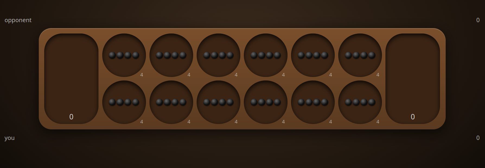

# p2p-mancala

**Play: https://franciscocarloserra.github.io/p2p-mancala/**

Mancala (Kalah, 6 pits x 4 stones) for 2 to 10 players, browser to browser over WebRTC via Trystero/Nostr. No server.

Open `index.html` (or the GitHub Pages site): it generates a `#room:password` link; send the whole link to your opponent. Whoever opens the room picks how many players (default 2); the game starts by itself once that many have opened the link, later arrivals watch. With 3+ players each row is a player, P1 on top: stones go left to right and down to the next row (the last row feeds P1), turns go top to bottom, captures take the same column from the player halfway around the table, and hovering a pit previews where it lands and what it captures. "xl" or Esc toggles a spreadsheet look.

The game is saved on each device (localStorage) and re-syncs on reconnect. To publish a new version, bump the version in `index.html` (`VERSION` and the `?v=` import) and in `version.txt`.

Limitations: no TURN server, so some strict networks won't connect. No referee: each client trusts the state the other sends. To test on one machine, open the second player in a private window (identity lives in localStorage).
